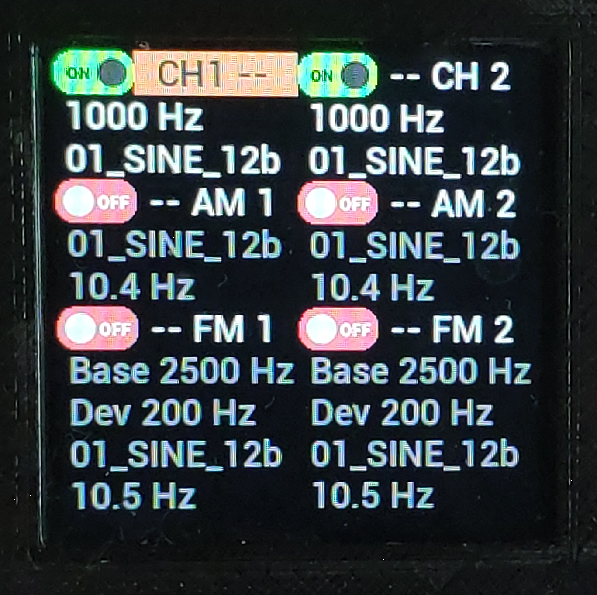

# Gen3

Сам проект генератор

Реализован:

MSD

мини Video плеер

[скрипты](#скрипты)

mp3 плеер



## Скрипты

Скрипт это текстовый файл на SD-карте: одна строка, одно действие на панели генератора. Он выполняется в фоне, поэтому меню и энкодер на главном экране продолжают работать.

```text
CH1 CR ON
DELAY 2000
CH1 CR OFF
DELAY 2000
GOTO 1
```

Выход две секунды включён, две секунды выключен, затем `GOTO 1` возвращает на первую строку. Скрипт идёт, пока его не остановят.

### Запуск

1. Положите файл с расширением `.txt` в папку `/script` на SD-карте. Карту можно подключить кардридером или через пункт настроек «USB MSD». В имени латинские буквы, цифры и `_`, до 14 символов.
2. На главном экране удержите кнопку, откроются настройки.
3. Выберите «Скрипт», затем файл. Скрипт запустится, и вернётся главный экран.

| Пункт настроек | Что делает |
|---|---|
| «Скрипт» | Список файлов из `/script`, клик запускает файл |
| «Скрипт вид» | Показывает скрипт и подсвечивает текущую строку. Энкодер листает, клик выходит или продолжает `WAIT`, удержание открывает редактор |
| «Скрипт Stop» | Останавливает скрипт. Сигнал не выключается: генератор остаётся в последнем состоянии |
| «Редактор» | Правка скрипта энкодером, см. [Редактор на устройстве](#редактор-на-устройстве) |

Если на карте нет сохранённой конфигурации `/Config/ch1.ini`, при включении запускается `/script/load_def.txt`.

На экранах «Фильтр», «Видео» и «BT Audio» скрипт стоит и продолжает работу после возврата. «Плеер» и «USB MSD» передают управление другой прошивке, и скрипт на этом заканчивается.

### Формат файла

- Одна команда на строке, слова разделены пробелами. Регистр букв важен: `DELAY`, а не `delay`.
- Номер строки это её порядковый номер в файле, считая с 1. Пустая строка занимает номер и ничего не делает.
- В строке до 22 байт, остальное обрезается. Русская буква занимает 2 байта.
- В файле до 127 строк.
- Дробная часть пишется через точку: `10.5`.

Регистров десять, `F0`..`F9`. Это числа с плавающей точкой, при каждом запуске они равны нулю. В таблицах ниже `x` означает число или регистр: `CR1 FR 1000` и `CR1 FR F1` работают одинаково.

### Команды

**Генератор**

| Команда | Что делает | В редакторе |
|---|---|---|
| `CH1 CR ON`, `CH1 CR OFF` | Включает и выключает выход | |
| `CH1 AM ON`, `CH1 AM OFF` | Включает и выключает AM | |
| `CH1 FM ON`, `CH1 FM OFF` | Включает и выключает FM | |
| `CR1 FR x` | Частота несущей, Гц | 200..10000 |
| `CR1 MOD имя` | Форма несущей из `/Carrier/имя.dat` | Список файлов |
| `AM1 FR x` | Частота AM, Гц | 0.1..100 |
| `AM1 MOD имя` | Форма AM из `/Mod/имя.dat` | Список файлов |
| `FM1 BASE x` | Центральная частота FM, Гц | 200..5000 |
| `FM1 DEV x` | Девиация FM, Гц | 0.1..5000 |
| `FM1 FR x` | Частота FM, Гц | 0.1..100 |
| `FM1 MOD имя` | Форма FM из `/Mod/имя.dat` | Список файлов |

Диапазоны из последнего столбца ограничивают только ввод на устройстве, в файле можно написать другое значение. `CR1 FR` и `FM1 BASE` берут целые герцы от 0 до 65535: дробная часть отбрасывается, значения за пределами обрезаются. Имя формы должно быть не длиннее 14 символов, иначе строка не поместится.

Пока FM включена, частоту задаёт `FM1 BASE`, и `CR1 FR` на сигнал не влияет.

**Регистры**

| Команда | Что делает |
|---|---|
| `LOAD F1 x` | `F1 = x` |
| `PLUS F1 x` | `F1 = F1 + x` |
| `MINUS F1 x` | `F1 = F1 - x` |
| `MUL F1 x` | `F1 = F1 * x` |
| `DIV F1 x` | `F1 = F1 / x` |

В редакторе числа вводятся от 0 до 99999.9, а для `MUL` и `DIV` от 0.001 до 99.999. Отрицательное число там получают вычитанием: `LOAD F2 0`, затем `MINUS F2 50`.

**Ход выполнения**

| Команда | Что делает |
|---|---|
| `GOTO n` | Переходит на строку `n`. Здесь только число, регистр нельзя |
| `IF F1 < x` | Если условие ложно, переходит за `ELSE` или на `ENDIF` |
| `ELSE` | Начало ветки для ложного условия, необязательна |
| `ENDIF` | Конец блока `IF` |
| `DELAY x` | Пауза в миллисекундах. При нуле и меньше паузы нет |
| `WAIT` | Ждёт клик в окне «Скрипт вид». С главного экрана это окно открывается само |
| `YIELD` | Отдаёт ход экрану до следующего прохода |
| `END` | Останавливает скрипт |
| `T текст` | Комментарий, ничего не делает |
| `PRINTF` | Выводит `F0`..`F9` в отладочный лог RTT, на экране этого не видно |

В `IF` слева только регистр, справа `x`, сравнения: `<`, `<=`, `>`, `>=`, `==`, `!=`. Числа с дробной частью надёжнее сравнивать через `>=` и `<=`: после сложений `==` может не сработать из-за округления.

Вкладывать `IF` в `IF` нельзя, потому что ложное условие ищет ближайший `ELSE` или `ENDIF`. Выйти из блока через `GOTO` можно, на этом строятся циклы в примерах.

За один проход выполняется не больше 128 команд, поэтому цикл без `DELAY` устройство не вешает.

### Примеры

Строки в `GOTO` считаются с первой строки примера.

**Набор настроек.** Скрипт может просто выставить панель и остановиться. Так устроен `load_def.txt`:

```text
T Default
CR1 FR 1000
CR1 MOD 01_SINE_12b
CH1 CR ON
AM1 FR 10.4
AM1 MOD 01_SINE_12b
CH1 AM OFF
FM1 BASE 2500
FM1 DEV 200
FM1 FR 10.5
FM1 MOD 01_SINE_12b
CH1 FM OFF
END
```

**Линейный свип.** От 200 до 5000 Гц шагом 50 Гц каждые 100 мс, примерно за 10 секунд, и снова с начала:

```text
LOAD F1 200
CR1 FR F1
DELAY 100
PLUS F1 50
IF F1 <= 5000
GOTO 2
ENDIF
GOTO 1
```

**Логарифмический свип.** Каждый шаг умножает частоту на 1.02, от 200 Гц до 10 кГц тоже примерно за 10 секунд:

```text
LOAD F1 200
CR1 FR F1
DELAY 50
MUL F1 1.02
IF F1 < 10000
GOTO 2
ENDIF
GOTO 1
```

Свип вниз получится, если начать с `LOAD F1 10000`, заменить `MUL` на `DIV` и поставить условие `IF F1 > 200`.

**Пачка импульсов.** Пять импульсов по 100 мс, секунда тишины, и снова. `F0` считает оставшиеся импульсы:

```text
LOAD F0 5
CH1 CR ON
DELAY 100
CH1 CR OFF
DELAY 100
MINUS F0 1
IF F0 > 0
GOTO 2
ENDIF
DELAY 1000
GOTO 1
```

**Смена форм.** Синус, треугольник и меандр по две секунды:

```text
CH1 CR ON
CR1 MOD 01_SINE_12b
DELAY 2000
CR1 MOD 13_TRIAGLE
DELAY 2000
CR1 MOD 14_Square
DELAY 2000
GOTO 2
```

**Измерение по точкам.** Скрипт выставляет частоту и ждёт клик, пока вы снимаете показания. Шаг 100 Гц, от 200 до 5000 Гц:

```text
LOAD F1 200
CR1 FR F1
WAIT
PLUS F1 100
IF F1 <= 5000
GOTO 2
ENDIF
END
```

**Пауза из регистра.** Импульс 50 мс, а пауза сжимается с 500 до 60 мс на 20 мс за шаг:

```text
LOAD F1 500
CH1 CR ON
DELAY 50
CH1 CR OFF
DELAY F1
MINUS F1 20
IF F1 > 40
GOTO 2
ENDIF
GOTO 1
```

**Развилка.** AM включается и выключается через секунду. `F0` помнит, какой сейчас проход:

```text
LOAD F0 0
PLUS F0 1
IF F0 == 1
CH1 AM ON
ELSE
CH1 AM OFF
LOAD F0 0
ENDIF
DELAY 1000
GOTO 2
```

**Ступени девиации.** FM включена, поэтому центральную частоту задаёт `FM1 BASE`. Девиация растёт от 50 до 500 Гц раз в секунду, потом скрипт останавливается, а сигнал остаётся:

```text
CH1 CR ON
FM1 BASE 1000
FM1 FR 5
FM1 MOD 01_SINE_12b
CH1 FM ON
LOAD F1 50
FM1 DEV F1
DELAY 1000
PLUS F1 50
IF F1 <= 500
GOTO 7
ENDIF
END
```

### Ошибки

Скрипт останавливается на строке, в которой есть одна из этих ошибок:

- неизвестная команда, например `GOT 5`;
- чужой регистр, например `PLUS F10 5`;
- нет операнда, например `CR1 FR`;
- неверное сравнение, например `IF F1 = 2`;
- деление на ноль: `DIV F1 F2` при `F2 = 0`, значение `F1` при этом не меняется;
- `IF` или `ELSE` без `ENDIF`.

Чтобы её найти, откройте «Скрипт вид»: в заголовке будет STOP, а ошибочная строка останется подсвеченной.

Остальное скрипт не заметит:

- опечатку во втором слове, например `CR1 XX 5`;
- нечисловое значение: `CR1 FR abc` выставит 0 Гц;
- несуществующий файл формы: скрипт пойдёт дальше, но форма сигнала окажется не той.

Команды `CH2`, `CR2`, `AM2` и `FM2` остались в старых файлах от второго канала, сейчас они молча пропускаются.

### Точность времени

`DELAY` считает миллисекунды, но сигнал меняется только при заполнении следующего буфера ЦАП, раз в 4.1 мс. Кроме того, пока кадр уходит на экран, скрипт стоит, а кадр занимает около 40 мс. Главный экран перерисовывается от команд скрипта не чаще 5 раз в секунду, окно «Скрипт вид» до 20 раз.

Поэтому шаг короче 50 мс может растянуться. Эти числа рассчитаны по коду, на осциллографе их не проверяли.

Если нужен точный ритм, используйте AM с формой `14_Square`: она идёт с точностью до отсчёта ЦАП, это 2 мкс. Число импульсов так не задать, зато скрипт может менять `AM1 FR` и включать AM на нужное время.

### Редактор на устройстве

Вход: пункт «Редактор» в настройках или удержание в окне «Скрипт вид». Редактор открывает загруженный скрипт, а работающий скрипт в это время продолжает выполняться.

| Действие | Результат |
|---|---|
| Энкодер | Выбор строки |
| Клик по строке | Вставить выше, Изменить, Копия, Переместить, Удалить |
| Клик по «+ в конец» | Новая строка в конце |
| Удержание | Назад, Запуск, Стоп, Сохранить, Сохранить как, Новый, Открыть, Выход |

Команда собирается из клеток: сначала блок, затем операнды. `MUL`, `DIV` и `WAIT` лежат в клетке «Еще». Число вводится по разрядам: поворот меняет значение, клик переходит к следующему разряду, удержание завершает ввод.

Номера в `GOTO` пересчитываются сами при вставке, удалении и перемещении строк. Перед запуском и сохранением редактор дописывает `END`, если последняя строка другая, и проверяет `IF`, `ELSE`, `ENDIF` и номера в `GOTO`. Найденную ошибку он показывает, но запускать и сохранять не запрещает.

`T` и `PRINTF` в редакторе не набрать. В готовом файле такие строки сохраняются.

### Android-версия

В приложении [GeneratorAndroid](https://github.com/Sacamoto84/GeneratorAndroid) похожий язык, но файлы напрямую не переносятся. Там расширение `.sk`, `GOTO` считает строки с нуля, а команд `T`, `YIELD`, `PRINTF`, `MUL`, `DIV`, `WAIT` и `DELAY F1` нет.
